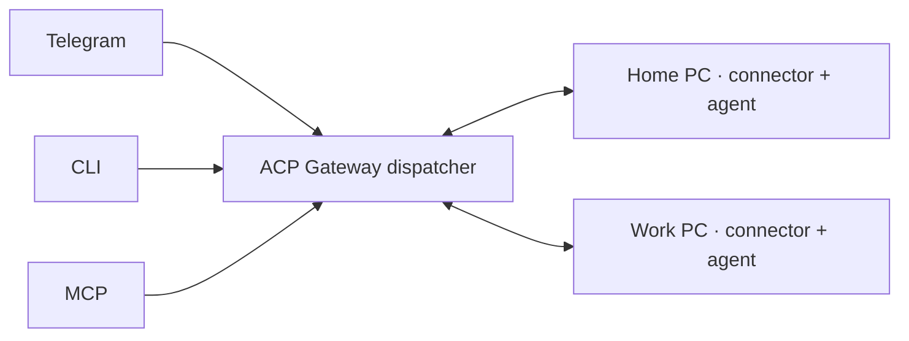

# ACP Gateway

**Your agents, on your computers — available from Telegram, CLI and MCP.**

ACP Gateway connects a central dispatcher to agents running on your PCs.
Choose an agent and a dialogue, send a task, review approval requests and
receive the answer without opening a remote desktop.

[](LICENSE)
[](pyproject.toml)
[](https://pypi.org/project/acp-gateway/)

[Install](docs/setup/self-install-pypi.ru.md) · [Documentation](docs/README.md) · [Roadmap](road-map.md)

## How it works



Connectors initiate the connection to the dispatcher. The agents execute tasks
on their own computers; the dispatcher routes messages, results and approvals.
Hermes Desktop and Goose integrations are described in the documentation.

## What you can do

- Work with agents on multiple PCs through one Telegram bot.
- Create and switch dialogues, retrieve saved answers and handle approvals.
- Choose available models and execution modes when supported by the agent.
- Use the CLI or MCP interface alongside Telegram.
- Install the same package as a dispatcher or connector, with separate setup sections.

## Install

Install [uv](https://docs.astral.sh/uv/getting-started/installation/), then:

```sh
uv tool install --python 3.12 "acp-gateway==0.2.1"
uv tool update-shell
acpgw setup
```

The current release is **0.2.1**: one dispatcher, outgoing connectors from your PCs,
Telegram dashboards and approvals, managed updates and an optional independent
companion for updates from Telegram. See [project status](docs/project-status.md)
and the [0.2.1 upgrade instructions](docs/setup/update-0.2.1.ru.md).

Follow the [Ubuntu dispatcher + Windows/Hermes guide (Russian)](docs/setup/self-install-pypi.ru.md)
for enrollment, connection, Telegram and autostart. For an existing installation,
use the [update and recovery guide](docs/setup/maintenance.md).

To run the dispatcher in Docker on your VPS — behind the reverse proxy you
already have, with your own nginx, or by moving a native dispatcher into Docker
without re-enrolling computers — see the
[Docker dispatcher guide (Russian)](docs/setup/vps-docker.ru.md).

## Explore

| I want to… | Start here |
| --- | --- |
| Set up Telegram | [Bot setup and commands](docs/setup/telegram.md) |
| Run the dispatcher in Docker on a VPS | [Docker dispatcher (Russian)](docs/setup/vps-docker.ru.md) |
| Understand support and limitations | [Project status](docs/project-status.md) |
| Configure a different deployment | [Documentation index](docs/README.md) |
| Develop or build from source | [Development guide](docs/development.md) |
| See what comes next | [Roadmap and queue](road-map.md) |

## License

[MIT](LICENSE)
