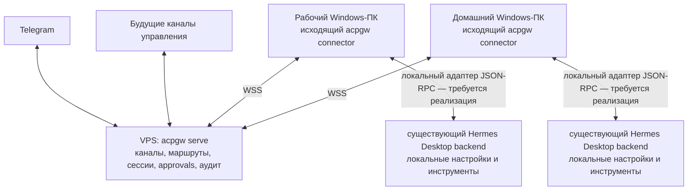

# VPS-диспетчер и Hermes на двух Windows-хостах

Дата проверки: 2026-10-12. Это оценка текущего рабочего дерева, включая
неопубликованные изменения CLI. Развёртывание на VPS и проверка физических
Windows-ПК в рамках оценки не выполнялись.

## Начало реализации P4.8.1

После оценки выполнен spike на доступном Windows Desktop 0.21.6: добавлены
`acpgw agents probe hermes` и `scripts/spike_hermes.py`. Два независимых клиента
подключились к одному тестовому диалогу backend, получили поток и завершение
одного модельного запроса; отключение первого не оборвало второго. Resume
по сохранённому ID также проверен, live ID при этом изменился. Визуальная
приёмка той же вкладки Desktop ещё нужна. Production-адаптера пока нет.

Обнаружены ограничения busy/interrupt: занятый backend может queue/steer вместо
отказа, отмена сессии не гарантирует отмену именно хода Gateway. Это требуется
решить до подключения production-релея. Подробности, команды и границы проверки:
[Hermes attach](../setup/hermes-attach.md). Следующий раздел описывает более
раннюю read-only диагностику; её ограничения не заменяют результаты spike.

## Уточнение: проверен установленный Windows Desktop

После первоначальной оценки владелец уточнил: оба ПК используют нативный
Hermes Desktop; предпочтительно подключаться к его существующему backend.
На доступном Windows-хосте EXAMPLE-DESKTOP выполнена локальная проверка из WSL
через Windows PowerShell. Второй физический ПК не проверялся.

- Найден работающий Desktop:
  `C:\Users\vladz\AppData\Local\hermes\hermes-agent\apps\desktop\release\win-unpacked\Hermes.exe`.
- Desktop запустил `hermes.exe serve --host 127.0.0.1 --port 0`, который владеет
  Python-backend. На момент проверки Python PID — 18748, порт — 4549.
  Эти значения временные, их нельзя фиксировать в настройках коннектора.
- `GET /api/status` сообщает версию **0.21.6**.
- `GET /api/host/identity` подтвердил роль `desktop-serve` и PID backend.
- Отдельный клиент успешно открыл `/api/ws` с локальным токеном и получил
  успешный JSON-RPC-ответ на `session.active_list`. На момент проверки —
  0 живых сессий; совместная работа с Desktop в одном диалоге не проверена.
- Обнаружены `host-desktop-serve.json` и `host-desktop-serve.token` в
  `%USERPROFILE%\.local\state\hermes\gateway-locks`. Установленный исходник
  `gateway/host_rendezvous.py` прямо предусматривает обнаружение Desktop-backend
  клиентами под той же OS-учётной записью. Значение токена не выводилось.
- Установленный `tui_gateway/session_transports.py` реализует добавление
  клиентов к живой сессии через `FanoutTransport`, без замены существующего
  клиента. Это подтверждение кода, не выполненный тест общего диалога.

Проверка не отправляла prompt, не запускала модель, не принимала решений
approvals, не останавливала Desktop и не меняла его конфигурацию.

**Актуальный предпочтительный вариант:** коннектор обнаруживает существующий
Desktop-backend, проверяет его идентичность и подключается к его JSON-RPC API
по loopback. Локальный токен остаётся на ПК. Нужен адаптер между этим API и
существующим ACP-контрактом релея; одинаковый WebSocket-транспорт не означает
совместимость протоколов. До реализации проверить новые/живые/сохранённые
сессии, события, busy-поведение, approvals и отмену в тестовом диалоге.

При закрытии backend маршрут должен становиться недоступным; после его
повторного запуска коннектор заново обнаруживает порт/токен и подключается.
Нельзя незаметно запускать независимый Hermes или повторять незавершённое задание.
Если впоследствии нужна работа при полностью завершённом Desktop, можно
обсудить независимо управляемый общий `hermes serve` и подключение Desktop к нему.

Разделы ниже сохраняют первоначальную оценку ACP/stdio-варианта. Stdio-транспорт
и его Windows cwd-политика обязательны именно для того варианта; при прямом
подключении к Desktop приоритет получает адаптер Hermes JSON-RPC. Windows
автозапуск коннектора, политика локального доступа и приёмка двух ПК нужны
в обоих случаях.

## Целевая схема

### Общее требование: подключение к существующим агентам

Владелец подтвердил, что первичная настройка должна уметь находить и подключать
уже установленные и работающие агенты. Hermes и Goose — первые адаптеры,
а не ограничение списка. Целевые окружения: Windows native, macOS, Linux и WSL.
Это требование к реализации; перечисление платформ не означает завершённую
приёмку на каждой из них.

| Агент и интерфейс | Предпочтительное подключение | Что ещё проверять |
|---|---|---|
| Hermes Desktop / `hermes serve` | Существующий локальный JSON-RPC/WebSocket backend, обнаружение через rendezvous | Версия, профиль, identity, живые/сохранённые сессии, approvals и события |
| Goose Desktop / `goose serve` | Существующий ACP/WebSocket backend | Обнаружение endpoint и credentials, capabilities, возможность совместного доступа к живой сессии конкретной версии |
| Агент без внешнего интерфейса, например отдельный интерактивный CLI | Показывать установленный/работающий, но недоступный для attach экземпляр | Предложить включить поддерживаемый интерфейс либо отдельно выбрать управляемый процесс; не запускать его скрытно |
| Другой ACP-агент | Ручной endpoint и ACP initialize | Реальные capabilities, auth, ограничения и поддержка сессий |

Транспорт и адаптер агента должны быть отделены от обнаружения окружения
и управления автозапуском. Для macOS нужен свой lifecycle (например LaunchAgent),
для Linux/WSL — существующая systemd-интеграция, для Windows — Task Scheduler.
Совместимость ОС также зависит от доступности самого upstream-агента и сборки
для выбранной архитектуры; нельзя обещать любую Desktop-сборку на любом Mac/Linux.

Предпочтительно размещать коннектор в том же окружении и под тем же пользователем,
что и агент. Windows и каждая WSL-дистрибуция — разные окружения: отдельные
процессы, настройки, credentials, пути и сетевые условия. Работающий агент
в WSL не становится автоматически Windows loopback-агентом и наоборот.
Первый надёжный вариант — собственный connector в каждом используемом окружении,
с разными ID (например `home-win`, `home-wsl`). Один connector с доступом сразу
к обоим окружениям можно добавить через явные адаптеры и проверенные endpoints.
Нельзя запустить два connector под одним ID: новое подключение заменит старое.

Предлагаемый сценарий setup:

1. Найти локальные установки и активные интерфейсы через данные приложения,
   процессы и известные локальные endpoints; не сканировать всю LAN.
2. Показать агент, версию, окружение, профиль, доступность интерфейса и доступные
   способы работы с сессиями. Отличать установленный агент от готового endpoint.
3. Дать выбрать один или несколько найденных экземпляров, назначить стабильные
   локальные aliases; предусмотреть ручное добавление URL.
4. Проверить identity/auth и protocol handshake без prompt, model call и
   изменения существующего диалога. Токены остаются локальными.
5. Сохранить способ повторного обнаружения endpoint, чтобы смена PID/порта/токена
   при рестарте не ломала настройку; проверять новую identity перед подключением.
6. Настроить соединение с VPS и автозапуск только connector. Для внешнего агента
   attach-режим не даёт connector права останавливать, обновлять или перезапускать
   приложение. Отдельно предлагается явно выбранный managed-режим.

После настройки пользователь должен различать: «ПК подключён», «агент доступен»,
«нужна авторизация», «интерфейс не поддержан», «агент занят» и «агент остановлен».
Приёмка подключения к backend не заменяет приёмку общего живого диалога.
Для существующих Hermes/Goose сессий потребуется отдельное отображение и
явное привязывание к разговору Gateway: нынешний список Gateway-сессий сам по
себе не импортирует все диалоги Desktop.

Внешние основания: [Hermes platform support](https://github.com/NousResearch/hermes-agent/blob/main/website/docs/getting-started/platform-support.md),
[Goose Desktop architecture](https://github.com/aaif-goose/goose/blob/main/ui/desktop/README.md),
[Goose CLI / serve](https://github.com/aaif-goose/goose/blob/main/documentation/docs/guides/goose-cli-commands.md).



Коннекторы сами устанавливают соединение с VPS; входящие публичные порты на
ПК не нужны. Маршруты диспетчера — `work/hermes` и `home/hermes`.
Провайдерские ключи и рабочие файлы остаются на соответствующих ПК.
Диспетчер получает запросы, ответы и сведения для подтверждения действий.

Предпочтительный вариант — один фоновый коннектор под Windows-учётной записью
пользователя на каждом ПК, который подключается к уже существующему Desktop
backend через локальный адаптер. Это целевая архитектура, а не готовая команда
установки. Разделы stdio ниже сохранены как первоначальная оценка другого пути;
актуальная последовательность разработки находится в `P4.8` roadmap.

## Что уже есть

| Часть | Проверенное состояние |
|---|---|
| VPS runtime | `serve` объединяет ядро, каналы, approvals и отдельный вход коннекторов. Самостоятельный `dispatcher` — диагностический listener, не полноценный runtime заданий |
| Исходящие подключения | Регистрация, отдельные ключи ПК, WSS, keepalive, reconnect, отзыв/ротация, fencing по epoch |
| Несколько ПК | Адреса `computer/agent`, разделение истории, сессий, jobs и approvals; отключение одного ПК не должно затрагивать другой |
| Telegram | Выбор маршрута, текстовые задания, создание/переключение сессий, результат, отмена и кнопки approvals; приватный чат и allowlist пользователя |
| Размещение | Docker/Compose, nginx для отдельного WSS path, постоянное хранилище SQLite, healthcheck, ротация логов |
| Расширение каналов | Общий контракт каналов; подключение очередного интерфейса управления не должно требовать нового транспорта к ПК |
| Windows-поставка | Есть установка и часть lifecycle-проверок; это не подтверждает поддержку Windows-служб и полного Hermes end-to-end |

Основания: `src/acp_gateway/config.py`, `connectors/commands.py`,
`connectors/launch.py`, `connectors/control.py`, `connectors/relay.py`,
`channels/telegram.py`, `service.py`, `deploy/docker/compose.yaml`;
подробности существующего маршрута — [connector.md](connector.md).

Важно: существующий [Hermes MCP channel](../setup/hermes.md) решает другую
задачу: **Hermes вызывает инструменты Gateway для работы с агентами**.
Он не реализует направление **Telegram → диспетчер → Hermes-исполнитель**.
Тесты `test_hermes_compat.py` проверяют именно прежнее направление.

## Обязательные доработки

### 1. Локальный ACP-транспорт через stdio

Сейчас `AgentProfile` допускает локальный сетевой endpoint или удалённый
маршрут через connector. `AgentClient.open_transport()` открывает WebSocket,
а `connectors/commands.py` использует его для каждого локального потока.
Нет профиля команды и транспорта дочернего процесса.

Нужно добавить локальный stdio-профиль: исполняемый файл, массив аргументов,
рабочий каталог и выбранное окружение/Hermes home. Новый транспорт должен
соблюдать `AgentTransport` и оставаться за `PolicyTransport`.
Команда задаётся владельцем локально, не передаётся с VPS; запуск — без shell.
Нужны корректное JSON-RPC framing, ограничения размера сообщений, отдельный
stderr, обработка EOF, таймауты и остановка дерева дочерних процессов в Windows.
Владение процессом и число процессов/потоков нужно определить явно.

В текущей документации Hermes есть `hermes acp`, работающий через stdio,
и диагностика `hermes acp --check`. Режим использует существующее окружение
Hermes. Это позволяет сохранить ACP-релей и не писать переводчик всего API.
Версию и доступность ACP extra нужно проверить на каждом установленном Hermes.
Источник: [Hermes ACP Host Integration](https://github.com/NousResearch/hermes-agent/blob/main/website/docs/user-guide/features/acp.md).

### 2. Windows-пути в локальной политике

`connectors/policy.py::_cwd` использует `PurePosixPath` и прямо отвергает
обратную косую черту, UNC и пути без начального `/`. Поэтому `C:\Projects`
сейчас не пройдёт даже при наличии готового stdio-транспорта.

Нужны явные правила Windows-путей на стороне ПК: абсолютность, нормализация,
проверка против локально выбранного каталога и отказ от неоднозначных форм.
Семантика определяется целевым агентом, а не Linux-системой диспетчера.
Отдельно решить поддержку UNC, junction/symlink и регистронезависимого сравнения.
Ограничение ACP cwd само по себе не является файловой песочницей Hermes.

### 3. Фоновый запуск коннектора в Windows

`service.py::install`, `control` и `_systemctl` поддерживают только Linux/WSL.
Существующая Windows-задача удерживает WSL, а не запускает нативный коннектор.

Для первого этапа подходит Task Scheduler при входе пользователя, как уже
предусмотрено P3.2. Нужны install/start/stop/status/logs/uninstall,
запрет второго экземпляра, перезапуск после падения, отсутствие лимита времени
выполнения, корректные кавычки путей и завершение дочерних ACP-процессов.
Запускать под пользователем Hermes, с его профилем и доступом к credentials.
Автозапуск до входа пользователя — отдельное требование: не обещать его для
задачи, настроенной только «при входе». Доступ к enrollment key и логам
ограничивать Windows ACL; POSIX `chmod` эту задачу не решает.

### 4. Совместимость Hermes и подтверждений

Goose-режимы `approve`/`smart_approve` нельзя автоматически переносить на Hermes.
В проверенном текущем исходнике Hermes объявлены `default`, `accept_edits`,
`dont_ask`; для первого профиля предлагается явный `default`, согласованный
на ПК и VPS. Установленные версии могут отличаться.

Нужно проверить реальные `initialize`, `session/new`, `session/load`,
`session/prompt`, `session/cancel` и `session/request_permission`, включая
запросы разрешений на команды и редактирование. Проверить отказ, таймаут,
отсутствие человека и позднее решение после обрыва. Наличие ACP не означает,
что Hermes спрашивает разрешение на каждый вызов любого инструмента.
Источники: [Hermes ACP server](https://github.com/NousResearch/hermes-agent/blob/main/acp_adapter/server.py),
[permission bridge](https://github.com/NousResearch/hermes-agent/blob/main/acp_adapter/permissions.py).

### 5. Setup, диагностика и поставка

Добавить выбор существующего Hermes, проверку команды и ACP-зависимостей,
правильного Hermes home, каталога, провайдера и Windows-автозапуска.
Не пытаться использовать текущий пункт настройки Hermes MCP для этого маршрута.
Сначала проверять ACP без модели, затем выполнять намеренный тестовый prompt.
Выпустить пакет/бинарник с этими изменениями и обновить VPS/host runbook:
старый сценарий рассчитан на сетевой Goose в Linux/WSL.

## Вопрос, влияющий на выбор интерфейса

Нужно различать управление установленным Hermes с его настройками и управление
тем же уже открытым TUI/desktop-диалогом. ACP-процесс не следует считать
автоматическим подключением к живому TUI-процессу.

Если нужен именно общий живой диалог, сначала исследовать интерфейс существующего
Hermes gateway: его TUI JSON-RPC документирует подключение нескольких клиентов
к live session внутри одного gateway. Между независимыми процессами такой
гарантии нет. Это может потребовать отдельного адаптера вместо прямого ACP stdio.
Источник: [Hermes Programmatic Integration](https://github.com/NousResearch/hermes-agent/blob/main/website/docs/developer-guide/programmatic-integration.md).

## Минимальная последовательность работ

1. Уточнить установленную версию, способ запуска и потребность в общих живых
   диалогах. Проверить доступность `hermes acp --check` на обоих ПК.
2. Реализовать stdio-транспорт, Windows cwd и проверки на независимом mock.
3. Проверить реальный Hermes на одном Windows-ПК через foreground connector.
4. Реализовать и проверить Windows-автозапуск, логи, остановку и обновление.
5. Поднять VPS runtime `serve` с постоянным SQLite и WSS, зарегистрировать
   `home`/`work`, добавить `home/hermes`/`work/hermes`, включить отдельного
   Telegram-бота и `telegram` в разрешённых каналах подтверждения.
6. Проверить два физических ПК, затем зафиксировать release/runbook.

## Приёмка

- В Telegram `/agent home/hermes` и `/agent work/hermes` направляют задания
  на разные физические ПК; ответы, сессии и approvals не смешиваются.
- Многоходовый диалог сохраняется после переподключения и штатного рестарта.
- Запрос подтверждения доходит до Telegram; отказ и таймаут не выполняют действие.
- `/stop` завершает задание; фактическая остановка инструмента проверяется на ПК.
- Сон/пробуждение, потеря сети, перезапуск VPS, crash и Windows reboot с входом
  пользователя восстанавливают подключение без ручного терминала.
- Отключение/отзыв ключа одного ПК не затрагивает другой.
- Непонятный исход задания после обрыва не приводит к автоматическому повтору:
  действие могло уже выполниться. Offline-очереди и durable recovery результата
  сейчас нет; это допустимо для первой приёмки при явном отображении статуса.
- Проверены установка из новой поставки, автозапуск, логи и обновление на обоих ПК.

Для регулярной публичной работы использовать WSS. Owner API/MCP остаются
локальными; наружу публикуется только вход коннекторов. Один Telegram bot token
опрашивает один runtime.

## Проверка существующей основы

На текущем Linux-окружении выполнено:

```text
uv run --frozen pytest tests/integration/test_connector_multinode.py \
  tests/integration/test_telegram.py tests/unit/test_connector_policy.py -q
94 passed in 16.84s
```

Это проверка существующей маршрутизации, Telegram и локальной ACP-политики
на mock-агентах. Она не проверяет реального Hermes как исполнителя, Windows
автозапуск, публичный VPS или доставку через живого Telegram-бота.
Context7 в этой сессии недоступен; внешние сведения сверены с официальным
репозиторием Hermes, веткой main на дату проверки.
